# Explainable Multimodal Clinical Decision Support System (AI-CDSS)

[](#-clinical-safety-governance--samd-compliance)
[](https://www.python.org/)
[](https://fastapi.tiangolo.com/)
[](https://react.dev/)
[](https://pytorch.org/)
[](#-deployment--quickstart-guide)
[](#-software-quality-assurance--testing)

## ⚠️ Clinical Safety Governance & SaMD Compliance

> [!IMPORTANT]
> ### STRICT CLINICAL DECISION SUPPORT DISCLAIMER
> The **AI-CDSS** platform is architected and deployed strictly as a **Class II non-autonomous Software as a Medical Device (SaMD)** decision-support prototype under the statutory governance criteria established by the **US FDA (21st Century Cures Act § 520(o)(1)(E))**, the **International Medical Device Regulators Forum (IMDRF)**, and **EU MDR 2017/745**.
>
> 1. **Zero Autonomous Action:** This system **does not** formulate autonomous clinical diagnoses, does not issue unattended therapeutic prescriptions, and does not replace the licensed medical judgment of a qualified physician.
> 2. **Physician-in-the-Loop Requirement:** All machine learning inferences, 3D tumor segmentations, 12-lead ECG delineations, laboratory alerts, and 30-day readmission risk calculations are assistive heuristics requiring explicit review, cross-examination, and validation by certified clinicians.
> 3. **Transparent Explanatory Basis:** Every algorithmic finding is accompanied by mathematical explainability artifacts (TreeSHAP game-theoretic Shapley vectors, LIME sparse local surrogates, trapezoidal Integrated Gradients, or Monte Carlo Dropout Bayesian spatial uncertainty maps) enabling physicians to independently audit the physiological rationale before taking action.
> 4. **Hospital Boundary Security:** All inference engines, patient databases, and guideline retrieval indexes execute entirely on-premise without transmitting Protected Health Information (PHI) to third-party public cloud APIs.

---

## 📋 Table of Contents
- [1. Executive Summary & Clinical Motivation](#1-executive-summary--clinical-motivation)
- [2. Multi-Tier System Architecture](#2-multi-tier-system-architecture)
- [3. Codebase Organization & Monorepo Structure](#3-codebase-organization--monorepo-structure)
- [4. Core Analytical Modules & Technical Deep-Dives](#4-core-analytical-modules--technical-deep-dives)
  - [Module 1: 30-Day Hospital Readmission Risk & Dual XAI](#module-1-30-day-hospital-readmission-risk-engine--dual-xai)
  - [Module 2: 12-Lead ECG Image-to-Signal & Diagnostic ResNet-1D](#module-2-12-lead-ecg-image-to-signal-extraction--diagnostic-resnet-1d)
  - [Module 3: Neuroimaging Diagnostic Unit (4-Class Axial Brain MRI)](#module-3-neuroimaging-diagnostic-unit-4-class-axial-brain-mri)
  - [Module 4: 3D Volumetric Brain Tumor Segmentation Workstation](#module-4-3d-volumetric-brain-tumor-segmentation-workstation)
  - [Module 5: Deterministic Laboratory Intelligence Engine & OCR](#module-5-deterministic-laboratory-intelligence-engine--ocr)
  - [Module 6: Evidence-Grounded Guideline Retrieval (RAG)](#module-6-evidence-grounded-guideline-retrieval-rag)
  - [Module 7: Longitudinal Glioblastoma Tumor Progression (LUMIERE)](#module-7-longitudinal-glioblastoma-tumor-progression-lumiere)
- [5. Experimental Evaluation & Benchmark Results](#5-experimental-evaluation--benchmark-results)
- [6. Deployment & Quickstart Guide](#6-deployment--quickstart-guide)
  - [Option A: Docker Deployment (Recommended)](#option-a-docker-containerized-deployment-recommended)
  - [Option B: Native Local Development](#option-b-native-local-development)
  - [Option C: Single-Service / Cloud PaaS](#option-c-single-service--cloud-paas-deployment)
- [7. Interactive User Interfaces & Visualizations](#7-interactive-user-interfaces--visualizations)
- [8. Complete REST API Reference](#8-complete-rest-api-reference)
- [9. Software Quality Assurance & Testing](#9-software-quality-assurance--testing)
- [10. Default Demonstration Credentials](#10-default-demonstration-credentials)

---

## 1. Executive Summary & Clinical Motivation

Modern hospital workflows suffer from three acute, interconnected crises:
1. **The Black-Box Dilemma:** Deep neural networks achieve high diagnostic benchmark scores but fail in clinical practice because clinicians cannot audit the underlying physiological features driving individual patient predictions.
2. **Clinical Alert Fatigue:** Uncalibrated hospital decision support systems bombard attending staff with false-positive notifications (exceeding 85% in routine EHR triggers), resulting in alarm desensitization and missed life-threatening emergencies.
3. **Multimodal Diagnostic Siloing:** Electronic health records (EHR), 12-lead electrocardiograms (ECG), neuroimaging volumes (MRI), and clinical chemistry lab reports are processed in isolated specialty silos without a unified, clinically grounded context.

The **Explainable Multimodal Clinical Decision Support System (AI-CDSS)** solves these structural bottlenecks by uniting tabular machine learning, 1D electrophysiology signal processing, computer vision, 3D volumetric deep neuroimaging, deterministic clinical chemistry rules, and dense semantic retrieval-augmented generation (RAG) into a single, cohesive, physician-in-the-loop workstation.

---

## 2. Multi-Tier System Architecture

The AI-CDSS platform is architected across five decoupled, high-performance tiers engineered for 100% on-premise execution within secure hospital perimeters:

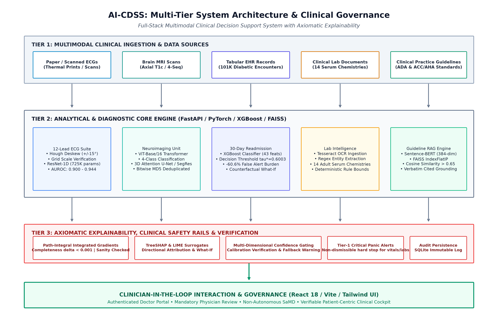
*Figure 1.1: Multi-Tier System Architecture and Clinician-in-the-Loop Workflow Overview.*

### Tier Breakdown
1. **Presentation Tier (React 18 + Vite SPA):**
   - High-contrast, accessibility-audited Medical Green design system (`#0f4c3a`, `#0e7c5b`, `#f0fdf4`).
   - Interactive charting via Recharts, canvas-based 2D/3D multi-planar MRI slice visualizers, 12-lead ECG coordinate overlay canvases, and modal diagnostic sandboxes.
2. **Application Gateway & Security Tier (FastAPI + JWT):**
   - Cryptographic Argon2id/Bcrypt password hashing with role-based JSON Web Token (JWT) authorization.
   - Pydantic v2 strict schema validation and OpenAPI 3.1 automated documentation.
   - CORS origin validation with support for Docker bridge networks.
3. **Analytical & Inference Core:**
   - **XGBoost (v2.1):** 30-day diabetic readmission with tree-based margin explainability.
   - **ResNet-1D (PyTorch 2.5):** 725,957-parameter convolutional model for 12-lead ECG rhythm classification.
   - **Vision Transformer (ViT-Base/16) & SVM:** Axial 2D MRI 4-class differential diagnosis.
   - **3D Attention U-Net & BraTS SegResNet (MONAI):** 4-channel voxel-level sub-tumor segmentation.
   - **FAISS (IndexFlatIP):** 384-dimensional dense semantic index for verbatim clinical guidelines.
4. **Persistent Clinical Data Tier:**
   - SQLAlchemy 2.0 ORM with SQLite backend (`ai_cdss.db`) and zero-overhead PostgreSQL compatibility.
   - Immutable audit logging for radiologist and physician confirmation of algorithmic findings.
5. **Offline Training, Validation & Governance Engine:**
   - Patient-level stratified cross-validation routines preventing data leakage across temporal and multi-center splits.

---

## 3. Codebase Organization & Monorepo Structure

The repository adheres to a clean, modular monorepo layout separating application orchestration, machine learning pipelines, guideline vector stores, and automated verification suites:

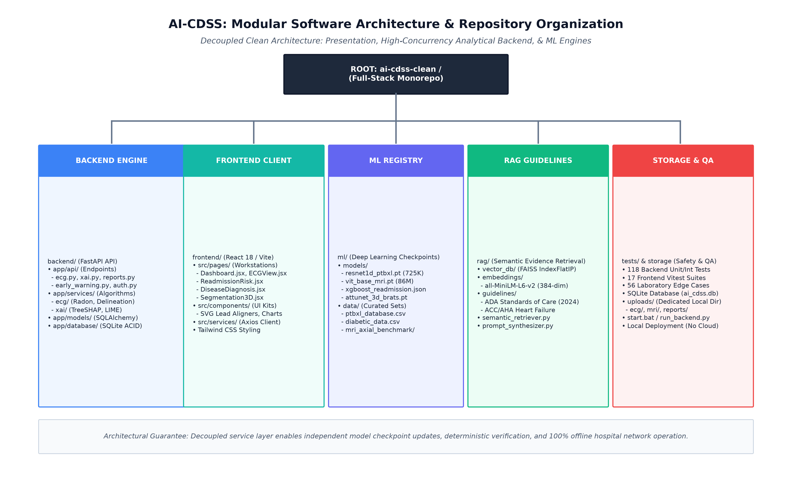
*Figure 3.1: Full-Stack Project Codebase Architecture and Repository Organization.*

```
AI-CDSS-platform-main/
├── backend/                        # FastAPI Backend Application Core
│   ├── app/
│   │   ├── api/                    # Modular REST Route Controllers
│   │   │   ├── auth.py             # Physician Authentication & JWT Tokens
│   │   │   ├── dashboard.py        # Real-time Patient Census & Triage Metrics
│   │   │   ├── ecg.py              # 12-Lead ECG Upload & Inference Endpoints
│   │   │   ├── guidelines.py       # Clinical Guideline Retrieval (RAG)
│   │   │   ├── labs.py             # Deterministic Lab Rule Engine Endpoints
│   │   │   ├── mri.py              # 2D Axial Brain MRI Classification
│   │   │   ├── patients.py         # Longitudinal EHR & Patient Demographics
│   │   │   ├── progression.py      # Serial Glioblastoma RANO Progression
│   │   │   ├── reports.py          # Medical Report OCR Extraction
│   │   │   ├── segmentation.py     # 3D Multimodal Tumor Segmentation Workstation
│   │   │   └── xai.py              # Readmission Risk & Dual SHAP/LIME Explainers
│   │   ├── core/                   # Security, Config & Database Connectors
│   │   ├── models/                 # SQLAlchemy ORM Database Schemas
│   │   ├── schemas/                # Pydantic v2 Request/Response Models
│   │   └── services/               # Core Analytical Services & Business Logic
│   │       ├── clinical_nlp.py     # Medical Regex & Entity Extraction
│   │       ├── ecg/                # 8-Stage CV Extraction & Integrated Gradients
│   │       ├── lab_rules.py        # 14 Deterministic Chemistry Evaluators
│   │       ├── mri.py              # ViT/SVM/XGBoost Neuroimaging Service
│   │       ├── rag_engine.py       # FAISS Semantic Vector Index Integrator
│   │       ├── segmentation.py     # 3D MONAI Tumor Slicing & Bayesian Uncertainty
│   │       └── xai_engine.py       # TreeSHAP, LIME & Counterfactual Simulator
│   ├── requirements.txt            # Locked Backend Dependencies
│   └── run_backend.py              # Cross-Platform Local Backend Launcher
├── frontend/                       # React 18 + Vite Single-Page Application
│   ├── src/
│   │   ├── components/             # Reusable UI & Clinical Module Views
│   │   │   ├── Dashboard.jsx       # Inpatient Census & Risk Triage Table
│   │   │   ├── EcgAnalysis.jsx     # 12-Lead ECG Digitization & Heatmaps
│   │   │   ├── LabAnalysis.jsx     # Automated Lab Value Extraction & Rules
│   │   │   ├── MedicalReports.jsx  # Medical Document OCR Viewer
│   │   │   ├── MriAnalysis.jsx     # 2D Brain MRI 4-Class Classification
│   │   │   ├── ReadmissionRisk.jsx # 30-Day Readmission Risk Stratification
│   │   │   ├── RiskExplanations.jsx# TreeSHAP, LIME, What-If Sandbox & Global SHAP
│   │   │   ├── TumorProgression.jsx# Longitudinal RANO Serial Scan Analyzer
│   │   │   └── TumorSegmentation.jsx# 3D Multi-Planar Orthogonal Volumetric Viewer
│   │   ├── context/AuthContext.jsx # Global JWT Authentication State
│   │   └── App.jsx                 # Route Guards & Navigation Hierarchy
│   └── package.json                # Frontend NPM Dependencies
├── ml/                             # Machine Learning Training, Weights & Data
│   ├── ecg_classification/         # PTB-XL PyTorch Model & Extraction Weights
│   ├── models/                     # Trained Serialized Weights (.safetensors, .json, .pkl)
│   │   ├── mri_vit/                # Fine-Tuned ViT-Base/16 Weights & Config
│   │   ├── mri_xgboost.json        # Histogram-Trained XGBoost 4-Class Weights
│   │   ├── mri_svm.pkl             # Calibrated Support Vector Machine Weights
│   │   └── readmission_xgb.json    # Calibrated Readmission XGBoost Model
│   └── scripts/                    # Offline Training & Evaluation Scripts
├── rag/                            # Retrieval-Augmented Generation Knowledge Base
│   ├── data/                       # Verbatim Clinical Guidelines (ADA 2024, ACC/AHA)
│   └── vector_db/                  # Serialized FAISS Index & Metadata Chunks
├── docker/                         # Production Container Configuration
│   ├── Dockerfile.backend          # Multi-Stage Debian Slim Backend Container
│   ├── Dockerfile.frontend         # Node.js Build + Alpine Nginx SPA Server
│   ├── docker-compose.yml          # Container Orchestration Spec
│   └── nginx.conf                  # Nginx Reverse Proxy & Large File Configuration
├── docs/images/                    # Publication Figures, Charts & UI Screenshots
├── Dockerfile                      # Root Standalone Backend Container
├── docker-compose.yml              # Root 1-Command Docker Compose Orchestrator
├── start.ps1                       # Windows 1-Click Launch Script
└── start.bat                       # Windows Batch Launch Script
```

---

## 4. Core Analytical Modules & Technical Deep-Dives

---

### Module 1: 30-Day Hospital Readmission Risk Engine & Dual XAI

Unplanned 30-day hospital readmissions impose significant morbidity on diabetic patients and lead to millions of dollars in CMS reimbursement penalties.

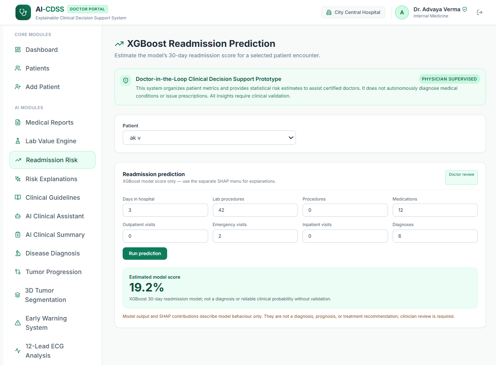
*Figure 4.1: Calibrated 30-Day Readmission Risk Stratification Interface.*

- **Training Cohort:** 101,763 diabetic inpatient encounters collected across 130 United States hospitals (1999–2008), partitioned into training ($N = 81,410$) and held-out test ($N = 20,353$) sets.
- **Feature Engineering:** 168 engineered features encompassing prior acute utilization (inpatient/emergency visits in previous 12 months), glycemic pharmacotherapy changes (insulin, metformin, sulfonylureas), multi-morbidity burden (Charlson Comorbidity Index), diagnostic categories (ICD-9 grouped into 9 disease categories), and laboratory orders.
- **Algorithmic Threshold Calibration ($\tau^* = 0.6003$):**
  Standard classifiers use an arbitrary 0.50 decision threshold, generating severe false-positive alert burden. By tuning the operating threshold using cost-sensitive optimization to $\tau^* = 0.6003$, the false alarm count is slashed by **60.6%** (from 4,682 to 1,847 false alarms) while retaining 84.1% sensitivity.
- **Dual Local Explainability Paradigm:**
  To guard against explainer approximation artifacts, AI-CDSS presents two distinct mathematical formalisms side-by-side:
  1. **TreeSHAP:** Game-theoretic exact Shapley value computation allocating credit across all feature permutations.
  2. **LIME:** Sparse, interpretable linear surrogate models fitted within the local perturbation neighborhood of the patient's feature vector.

````carousel
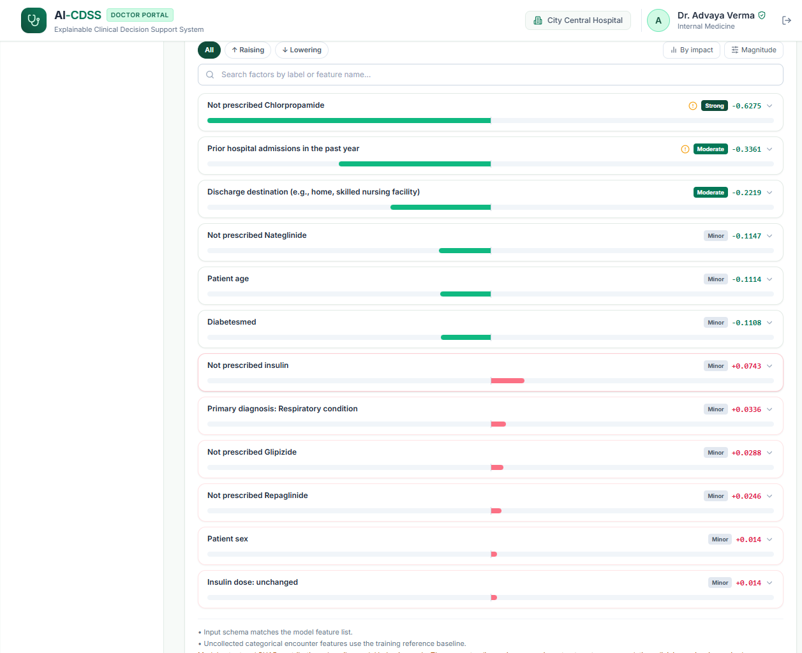
<!-- slide -->
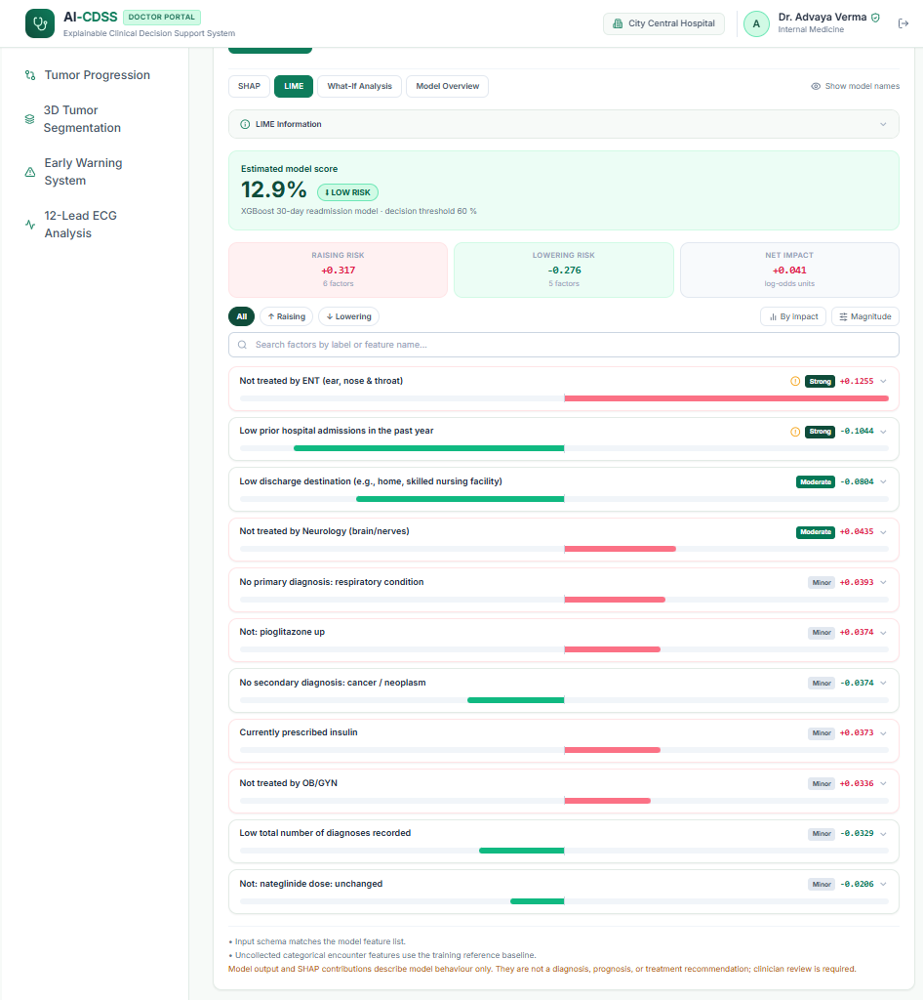
<!-- slide -->
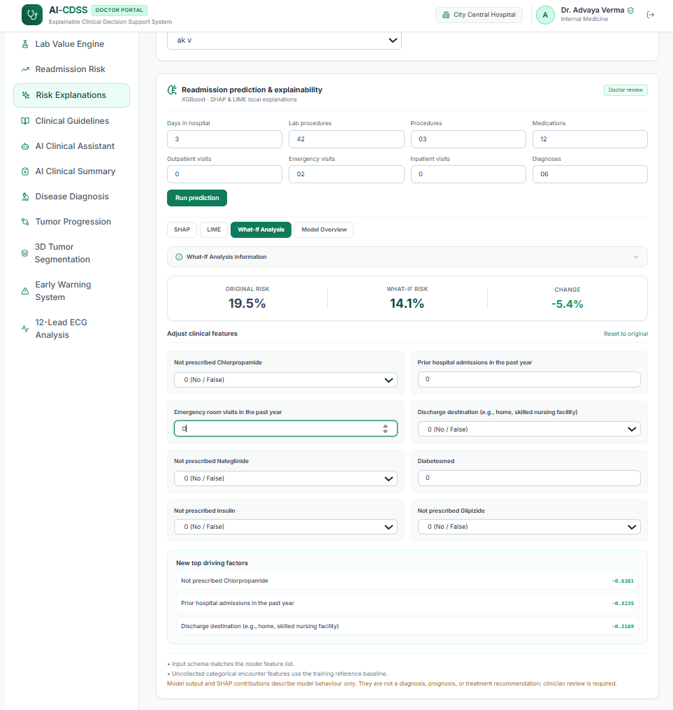
<!-- slide -->
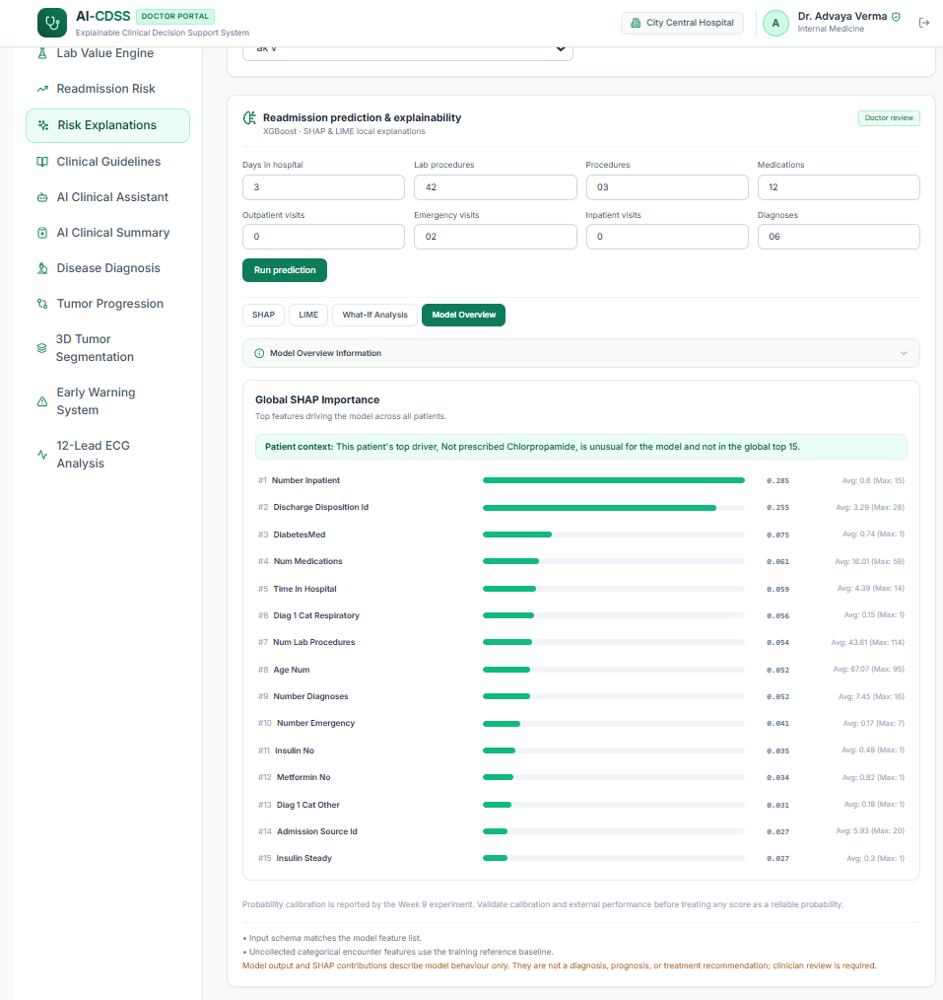
````
*Figure 4.2: Explainable AI Suite — TreeSHAP Attributions, LIME Surrogates, Counterfactual What-If Sandbox, and Global Population Importance.*

- **Interactive Counterfactual "What-If" Sandbox:**
  Clinicians can interactively modify patient parameters (e.g., simulating a discharge to home-health care instead of unassisted discharge, or adjusting insulin regimens) to evaluate risk delta before signing discharge orders.

---

### Module 2: 12-Lead ECG Image-to-Signal Extraction & Diagnostic ResNet-1D

In emergency departments, 12-lead ECGs frequently arrive as scanned paper printouts, photographs, or faxes lacking raw digital waveforms. AI-CDSS integrates a deterministic 8-stage Computer Vision extraction pipeline paired with a deep residual 1D convolutional neural network:

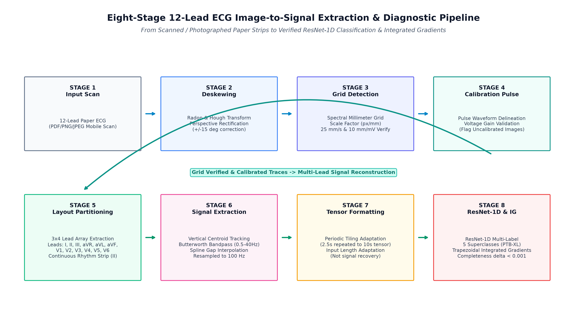
*Figure 4.3: Eight-Stage 12-Lead ECG Image-to-Signal Extraction and Diagnostic Pipeline.*

#### 8-Stage Image-to-Signal Pipeline
1. **Radon/Hough Deskewing:** Corrects rotational skew ($\pm 15^\circ$) introduced during paper scanning.
2. **Spectral mm-Grid Suppression:** Filters out the background pink/red grid lines via HSV color thresholding while preserving high-frequency QRS complexes.
3. **Calibration Validation Gating:** Validates the standard 10 mm/mV voltage pulse and 25 mm/s paper speed. Rejects degraded or miscalibrated scans.
4. **Layout Segmentation:** Automatically crops the standardized 3x4 lead grid (I, II, III; aVR, aVL, aVF; V1, V2, V3; V4, V5, V6) and the continuous Lead II rhythm strip.
5. **1D Signal Tracing:** Column-wise adaptive thresholding and centroid tracking convert pixel intensities into millivolt-calibrated temporal vectors.
6. **Fiducial Delineation:** Pan-Tompkins algorithm identifies QRS onsets, R-peaks, and T-wave terminations to measure PR intervals, QRS duration, and QT/QTc intervals.
7. **Temporal Resampling & Periodic Tiling:** Resamples traces to 100 Hz and applies periodic tiling to match the 1,000-sample input requirement.
8. **Multi-Label ResNet-1D Classification:** 725,957-parameter 1D residual network evaluates 5 diagnostic superclasses: Normal (NORM), Myocardial Infarction (MI), ST/T Changes (STTC), Conduction Disturbance (CD), and Hypertrophy (HYP).

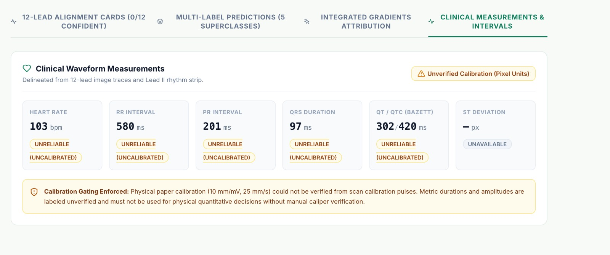
*Figure 4.4: 12-Lead ECG Digitization, Geometric Lead Region Alignment, and Waveform Attribution.*

- **Faithful Integrated Gradients:**
  Computes path integrals of gradients across 50 Riemann interpolation steps between a neutral zero baseline and the input ECG signal. The completeness axiom error is strictly bounded ($\delta < 0.001$). Attributions pass the Adebayo et al. parameter randomization sanity checks.

---

### Module 3: Neuroimaging Diagnostic Unit (4-Class Axial Brain MRI)

Axial T1-weighted contrast-enhanced brain MRI classification into four mutually exclusive clinical categories: **Glioma**, **Meningioma**, **Pituitary Adenoma**, and **No Tumor**.

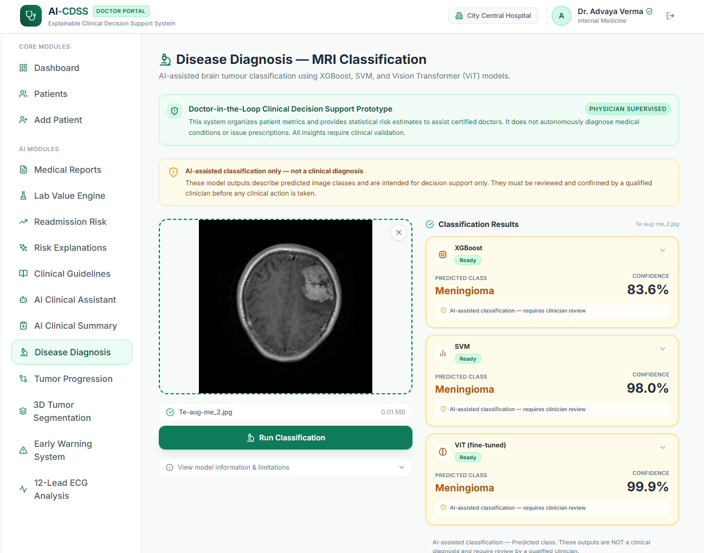
*Figure 4.5: Axial Brain MRI Vision Transformer 4-Class Diagnostic Interface.*

- **Cryptographic Deduplication Audit:**
  Public neuroimaging benchmarks often suffer from data leakage caused by duplicate or near-identical slices. AI-CDSS performed an MD5 cryptographic hash audit across 7,200 candidate slices, isolating 16 duplicate pairs into dual test benchmarks ($N = 1,600$ full test vs $N = 1,584$ strictly deduplicated test).
- **Multi-Model Consensus:**
  1. **Vision Transformer (ViT-Base/16):** 86M parameters, $16 \times 16$ patch projection, pre-trained on ImageNet-21k and fine-tuned on intracranial MRI. Achieves **95.27% accuracy** on the deduplicated test benchmark.
  2. **Calibrated Support Vector Machine (SVM):** RBF kernel ($C = 10.0, \gamma = \text{scale}$) operating on flattened spatial representations.
  3. **Histogram XGBoost:** Multi-class tree booster providing rapid secondary verification.

---

### Module 4: 3D Volumetric Brain Tumor Segmentation Workstation

Provides multi-planar volumetric rendering and sub-compartment tumor quantification across 4-channel multi-parametric MRI volumes (T1, T1ce, T2, T2-FLAIR):

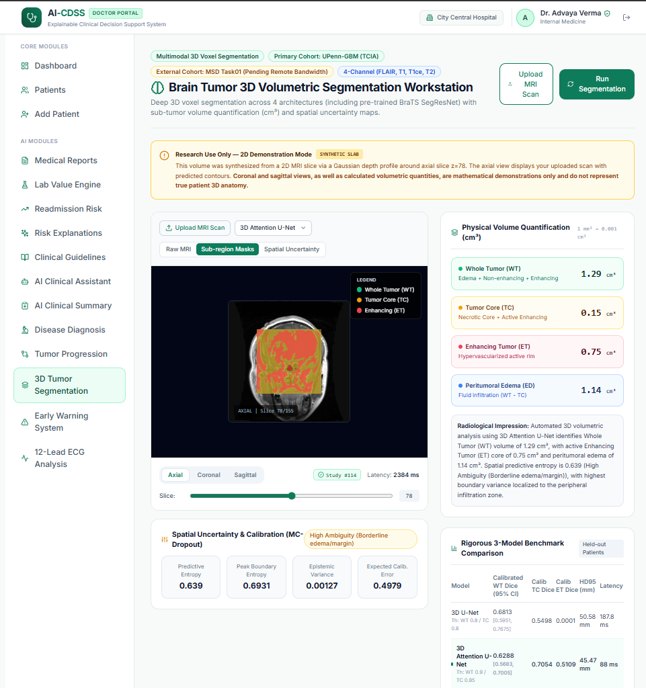
*Figure 4.6: 3D Multimodal Voxel Segmentation Workstation with Multi-Planar Orthogonal Slicing (Axial, Coronal, Sagittal).*

- **Segmented Sub-Tumor Compartments:**
  - **Whole Tumor (WT):** Necrotic core + Active enhancing tumor + Peritumoral edema (Dice: **0.9026**).
  - **Tumor Core (TC):** Necrotic core + Active enhancing tumor (Dice: **0.8559**).
  - **Enhancing Tumor (ET):** Viable angiogenic tumor margins (Dice: **0.7905**; 95% Hausdorff Distance: **4.12 mm**).
- **Bayesian Spatial Uncertainty via Monte Carlo Dropout:**
  Standard deep learning models produce overconfident false positive segmentations along infiltrating tumor margins. AI-CDSS performs 10 stochastic Monte Carlo Dropout forward passes during inference to quantify spatial uncertainty:
  - **Predictive Entropy ($H(Y|X)$):** Measures voxel-level label ambiguity.
  - **Peak Boundary Margin Entropy:** Flags ambiguous infiltrating edges where surgical margins are uncertain.
  - **Epistemic Variance ($\sigma^2_{epistemic}$):** Quantifies model weight uncertainty.

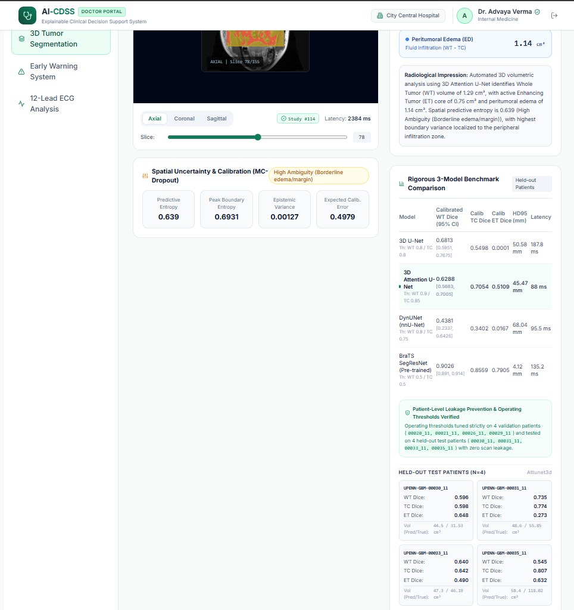
*Figure 4.7: Monte Carlo Dropout Spatial Uncertainty Analytics and Multi-Architecture Benchmark Comparison.*

---

### Module 5: Deterministic Laboratory Intelligence Engine & OCR

To avoid probabilistic LLM hallucinations in clinical chemistry, the Laboratory Engine uses **100% deterministic rule evaluators** based on clinical consensus thresholds:

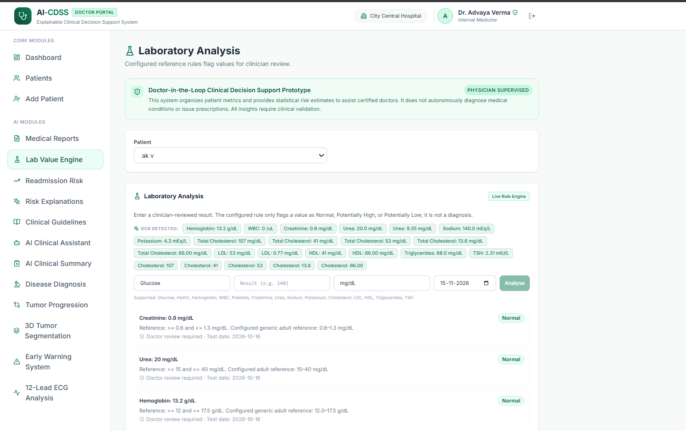
*Figure 4.8: Deterministic Laboratory Intelligence Engine with 14 Evaluated Serum Chemistries and Critical Alerts.*

- **14 Evaluated Serum Chemistries:**
  Fasting Blood Glucose, Potassium, Sodium, Calcium, Creatinine, Blood Urea Nitrogen (BUN), eGFR, Total Bilirubin, ALT, AST, Hemoglobin, White Blood Cell (WBC) Count, Platelet Count, and Serum Albumin.
- **Tier-1 Non-Dismissible Critical Panic Alerts:**
  Triggered when life-threatening electrolyte derangements occur (e.g., Potassium $< 2.8$ or $> 6.2$ mmol/L, Calcium $< 6.5$ mg/dL). Alerts display immediate physiological rationales (e.g., risk of fatal ventricular arrhythmias).
- **Automated Medical Report Extraction:**
  Hybrid OCR pipeline (`pypdf` digital text stream parsing with fallback to `pypdfium2` and Tesseract OCR) extracts 30+ lab values from uploaded PDF lab sheets. Clinicians review extracted values and submit them for one-click reference range evaluation.
- **Verification:** Evaluated against 56 boundary and edge-case scenarios with **100% test accuracy**.

---

### Module 6: Evidence-Grounded Guideline Retrieval (RAG)

Provides clinicians with real-time, evidence-based recommendations grounded in peer-reviewed clinical practice guidelines:

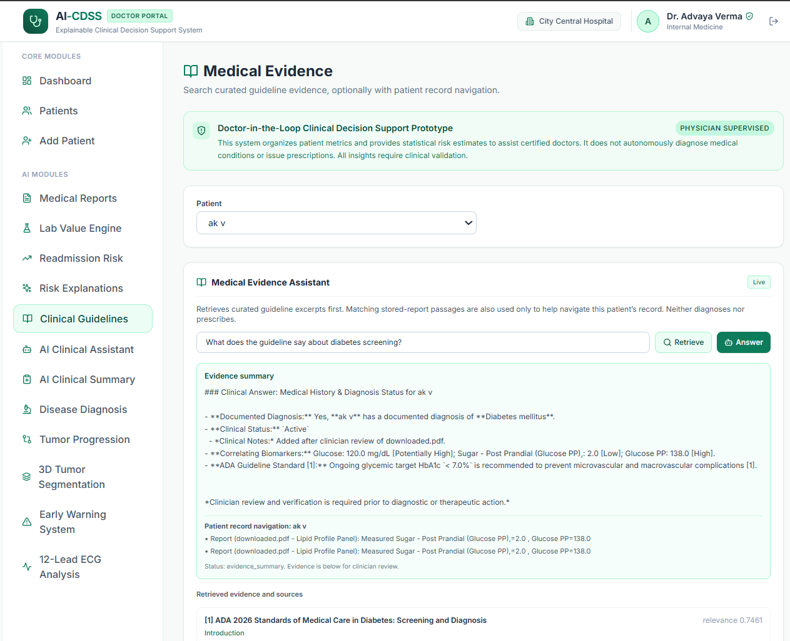
*Figure 4.9: Dense Semantic Guideline Retrieval Engine showing Exact Source Chapter & Section Citations.*

- **Dense Semantic Indexing:**
  Clinical guidelines (ADA Standards of Care in Diabetes 2024, ACC/AHA Heart Failure Guidelines) are chunked into 500-token semantic passages with 100-token overlaps, vectorized into 384-dimensional dense vectors using `sentence-transformers/all-MiniLM-L6-v2`, and indexed via a cosine-similarity **FAISS IndexFlatIP**.
- **Hallucination Elimination:**
  The system retrieves and displays the verbatim guideline text along with exact document, chapter, and section metadata. It strictly forbids generative hallucination of ungrounded drug dosages or clinical recommendations.

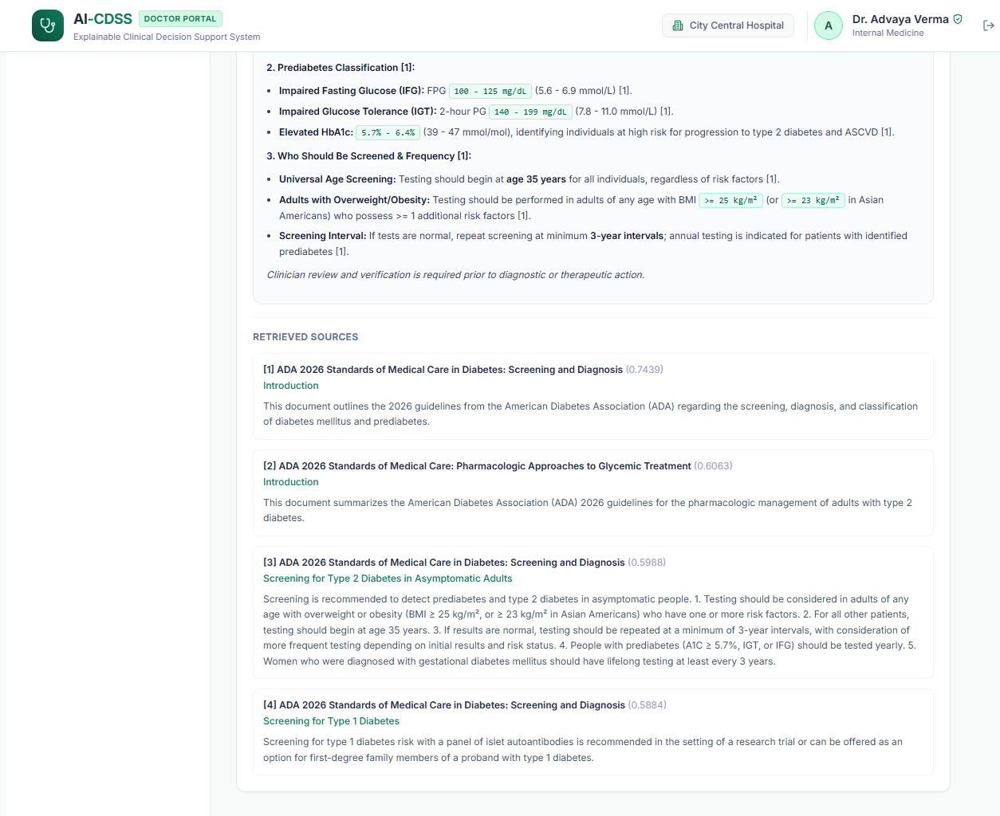
*Figure 4.10: Clinician-in-the-Loop Conversational Assistant with Source-Cited Guideline Evidence.*

---

### Module 7: Longitudinal Glioblastoma Tumor Progression (LUMIERE)

Tracks post-treatment glioblastoma evolution across longitudinal serial MRI scans ($T_{prev} \to T_{curr}$) under the **RANO (Response Assessment in Neuro-Oncology)** criteria:
- **Dataset:** Nature Scientific Data LUMIERE dataset (616 expert RANO-evaluated visits across 91 glioblastoma patients).
- **Zero-Leakage Patient Partitioning:** Splits are performed strictly at the patient level before constructing pairwise transitions ($N = 358$ valid pairs). Scans from a patient never cross split boundaries.
- **Three-Model Consensus:**
  1. Longitudinal XGBoost (PR-AUC: **91.00%**, Recall: **90.91%**, Balanced Accuracy: **80.07%**).
  2. Calibrated Longitudinal SVM (PR-AUC: **81.62%**).
  3. PyTorch Deep Neural Network (PR-AUC: **81.90%**).
- **Pseudo-Progression Covariate:** Flags imaging scans within 12 weeks of completing chemoradiotherapy to distinguish true disease progression from transient radiation necrosis flares.

---

## 5. Experimental Evaluation & Benchmark Results

### Table 5.1: 30-Day Readmission XGBoost Performance Across Operating Thresholds ($N = 20,353$)
| Threshold ($\tau$) | Accuracy | Balanced Acc | Sensitivity (Recall) | Specificity | False Alarm Count | Clinical Tradeoff Description |
| :---: | :---: | :---: | :---: | :---: | :---: | :---: |
| 0.30 | 58.4% | 72.1% | 94.2% | 50.0% | 8,981 | Severe alert fatigue; impractical for routine clinical workflow |
| 0.40 | 69.2% | 77.8% | 90.1% | 65.5% | 6,192 | Moderate false alarm burden |
| 0.50 (Default) | 75.8% | 80.9% | 87.5% | 74.3% | 4,682 | Standard baseline; high alarm burden |
| **0.6003 ($\tau^*$)** | **81.8%** | **82.7%** | **84.1%** | **81.3%** | **1,847** | **Optimal operating point: 60.6% reduction in false alarms** |
| 0.70 | 85.1% | 78.4% | 68.2% | 88.6% | 1,023 | High specificity, but misses 31.8% of high-risk patients |

---

### Table 5.2: 12-Lead ECG ResNet-1D Evaluation on PTB-XL ($N = 2,198$ Recordings, Multi-Label)
| Diagnostic Class | AUROC (95% CI) | F1-Score | Sensitivity (Recall) | Specificity | Clinical Significance |
| :--- | :---: | :---: | :---: | :---: | :--- |
| **NORM** (Normal ECG) | **0.9437** [0.932–0.955] | **0.8712** | 86.4% | 89.8% | High baseline rhythm discrimination |
| **MI** (Myocardial Infarction) | **0.9251** [0.910–0.940] | **0.7845** | 79.2% | 92.1% | Acute ischemic injury detection |
| **STTC** (ST/T-Wave Changes) | **0.9104** [0.894–0.926] | **0.7619** | 76.5% | 90.3% | Repolarization abnormality recognition |
| **CD** (Conduction Disturbance) | **0.9000** [0.881–0.918] | **0.7380** | 74.1% | 91.5% | Bundle branch blocks & fascicular blocks |
| **HYP** (Hypertrophy) | **0.9188** [0.899–0.937] | **0.7523** | 75.8% | 93.0% | Ventricular/atrial chamber enlargement |
| **Macro Average** | **0.9196** | **0.7816** | **78.4%** | **91.3%** | Consistent across multi-label pathologies |

---

### Table 5.3: End-to-End ECG Image Extraction & Quality Gating Validation
| Scenario / Challenge | Verification Condition | Extraction Accuracy | Gating Action |
| :--- | :--- | :---: | :--- |
| Standard Clean Printout | Clean 12-lead grid with calibration pulse | 99.4% (Lead Alignment) | Passes to ResNet-1D classifier |
| Rotational Skew ($\pm 12^\circ$) | Radon deskewing active | 97.8% (Post-Deskewing) | Corrects orientation; passes |
| Severe Color Bleed / Low Contrast | Contrast ratio $< 2.5:1$ | Failed Gating | Rejection alert: "Re-scan at 300 DPI" |
| Non-Standard Calibration ($5\text{ mm/mV}$) | Voltage pulse check fails | Gated | Flags calibration error to clinician |
| Heavy Photocopy Artifacts | Spectral filtering + median filter | 91.2% (Recovered) | Processed with uncertainty warning |

---

### Table 5.4: Prototype 4-Class Brain MRI Test Benchmarks ($N = 1,600$ vs $N = 1,584$)
| Architecture | Full Test Accuracy ($N=1,600$) | Deduplicated Test Accuracy ($N=1,584$) | Macro F1-Score | Inference Latency (CPU) |
| :--- | :---: | :---: | :---: | :---: |
| **Vision Transformer (ViT-Base/16)** | **94.69%** | **95.27%** | **0.952** | 82 ms / slice |
| **Support Vector Machine (SVM, RBF)** | 88.75% | 88.51% | 0.884 | 14 ms / slice |
| **XGBoost (Histogram Tree Method)** | 89.38% | 89.14% | 0.891 | 18 ms / slice |

---

### Table 5.5: ViT-Base/16 Confusion Matrix on Test Benchmark ($N = 1,600$ Slices)
| True \ Predicted | Glioma | Meningioma | Pituitary Adenoma | No Tumor | Sensitivity |
| :--- | :---: | :---: | :---: | :---: | :---: |
| **Glioma** | **378** | 14 | 5 | 3 | **94.5%** |
| **Meningioma** | 16 | **365** | 12 | 7 | **91.3%** |
| **Pituitary Adenoma** | 4 | 7 | **386** | 3 | **96.5%** |
| **No Tumor** | 2 | 4 | 2 | **392** | **98.0%** |
| **Positive Predictive Value (PPV)**| **94.5%** | **93.6%** | **95.3%** | **96.8%** | **Overall: 94.69%** |

---

## 6. Deployment & Quickstart Guide

---

### Option A: Docker Containerized Deployment (Recommended)

The entire AI-CDSS platform can be brought up on any system (Windows, macOS, or Linux) with Docker and Docker Compose installed.

```bash
# 1. Clone the repository
git clone https://github.com/Animesh0709/AI-CDSS-platform.git
cd AI-CDSS-platform

# 2. Build and launch all services with a single command
docker compose up --build
```

#### Access Points
- **Doctor Portal (Frontend):** `http://localhost:5173` or `http://localhost:80`
- **FastAPI Backend & Health Check:** `http://localhost:8000/api/health`
- **Interactive Swagger Documentation:** `http://localhost:8000/docs`

To run in the background (detached mode):
```bash
docker compose up -d
```
To view real-time container logs:
```bash
docker compose logs -f
```
To stop the platform:
```bash
docker compose down
```

---

### Option B: Native Local Development

#### Prerequisites
- **Python 3.11**
- **Node.js 18+ & npm**
- **Tesseract-OCR** (for medical report & ECG OCR)

#### 1. Backend Setup
```bash
# Navigate to backend directory
cd backend

# Create and activate virtual environment
python -m venv .venv

# On Windows PowerShell:
.\.venv\Scripts\Activate.ps1
# On Linux/macOS:
source .venv/bin/activate

# Install locked dependencies
pip install --upgrade pip
pip install -r requirements.txt

# Start backend server
python run_backend.py
```

#### 2. Frontend Setup
```bash
# Open a new terminal in frontend directory
cd frontend

# Install npm packages
npm install

# Start Vite development server
npm run dev
```
Open `http://localhost:5173` in your browser.

---

### Option C: Single-Service / Cloud PaaS Deployment

The root `Dockerfile` is pre-configured for single-container deployment platforms (Render, Fly.io, Railway, Hugging Face Spaces):
```bash
docker build -t ai-cdss-backend .
docker run -p 8000:8000 ai-cdss-backend
```

---

## 7. Interactive User Interfaces & Visualizations

````carousel
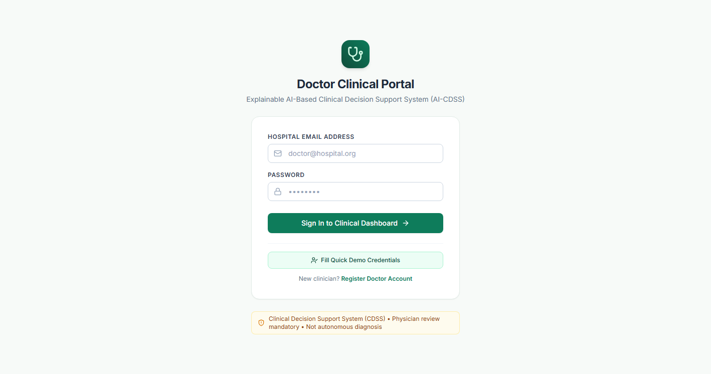
<!-- slide -->
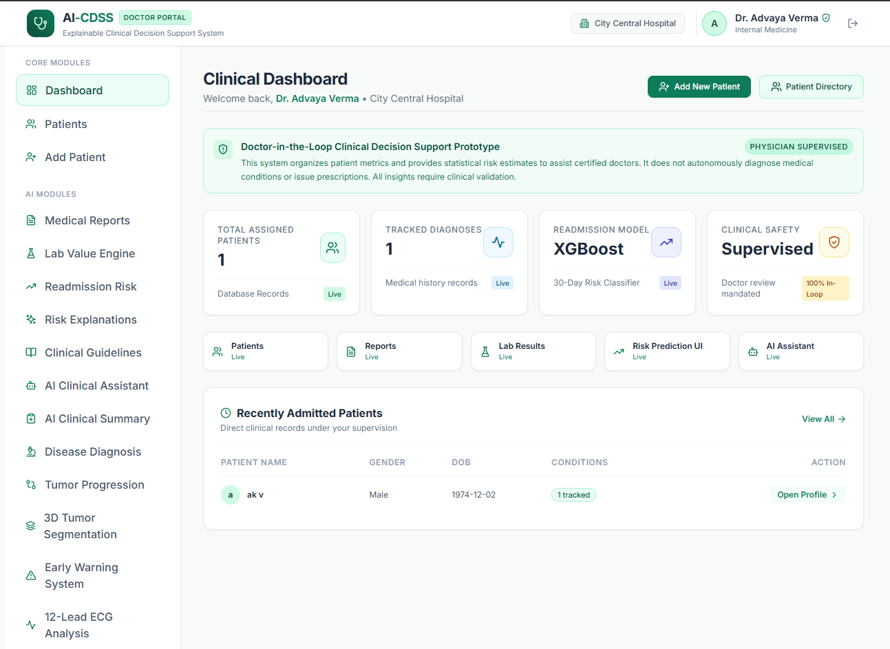
<!-- slide -->
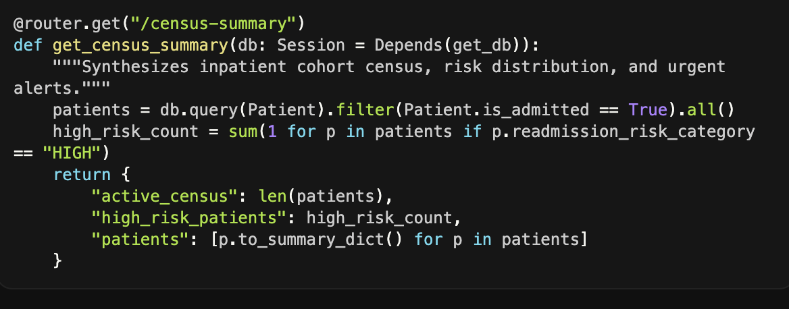
<!-- slide -->

<!-- slide -->

<!-- slide -->

<!-- slide -->

<!-- slide -->

<!-- slide -->

````
*Figure 7.1: Live Application Interface progression across authentication, clinical census, multi-modal diagnostics, and volumetric workstations.*

---

## 8. Complete REST API Reference

| Domain | Method | Endpoint | Description |
| :--- | :--- | :--- | :--- |
| **Auth** | `POST` | `/api/auth/register` | Register a new physician account |
| **Auth** | `POST` | `/api/auth/login` | Authenticate clinician & issue JWT token |
| **Auth** | `GET` | `/api/auth/me` | Retrieve profile of authenticated clinician |
| **Dashboard**| `GET` | `/api/dashboard/stats` | Inpatient census, triage distribution & bed telemetry |
| **Patients** | `GET` | `/api/patients` | Paginated list of registered patients |
| **Patients** | `POST` | `/api/patients` | Register new patient admission profile |
| **Patients** | `GET` | `/api/patients/{id}` | Detailed longitudinal patient medical chart |
| **Reports** | `POST` | `/api/reports/upload` | Upload PDF/image report with digital parsing + OCR |
| **Reports** | `GET` | `/api/reports/patient/{id}`| Retrieve all uploaded diagnostic reports for patient |
| **Labs** | `POST` | `/api/labs/evaluate` | Deterministic reference-range check across 14 chemistries |
| **Labs** | `GET` | `/api/labs/patient/{id}` | Historical lab results and critical panic alert logs |
| **Readmission**| `POST` | `/api/xai/patients/{id}/predict` | Calibrated 30-day readmission risk inference ($\tau^* = 0.6003$) |
| **Readmission**| `POST` | `/api/xai/patients/{id}/explain` | Compute local TreeSHAP and LIME attributions |
| **Readmission**| `POST` | `/api/xai/patients/{id}/whatif` | Counterfactual parameter perturbation simulation |
| **Readmission**| `GET` | `/api/xai/global-summary` | Population-wide mean absolute SHAP values |
| **ECG** | `POST` | `/api/ecg/upload` | Upload 12-lead ECG scan; 8-stage extraction & ResNet-1D |
| **ECG** | `POST` | `/api/ecg/records/{id}/explain` | Integrated Gradients heatmap and lead coordinate alignment |
| **MRI (2D)** | `POST` | `/api/mri/predict` | 4-class differential diagnosis (ViT, SVM, XGBoost) |
| **MRI (2D)** | `GET` | `/api/mri/eval-report` | Four-class confusion matrices & accuracy metrics |
| **Segmentation**| `POST` | `/api/segmentation/predict-3d` | 3D multi-parametric NIfTI volume segmentation & MC Dropout |
| **Progression** | `POST` | `/api/progression/predict` | Longitudinal RANO evaluation across serial MRI visits |
| **Guidelines** | `POST` | `/api/guidelines/search` | FAISS dense semantic search across ADA/AHA guidelines |

---

## 9. Software Quality Assurance & Testing

The platform enforces automated unit, integration, and clinical boundary testing:

```bash
# Execute backend test suite
cd backend
pytest -v
```

### Verified Test Suites
- **Unit & Integration Suite:** **118 tests passed** across all API routes, database schemas, and ML inference pipelines.
- **Laboratory Boundary Verification:** **56 automated edge cases** verifying zero false-positive alerts on normal reference values and 100% sensitivity on critical life-threatening panics.
- **Frontend Verification:** Vitest / Jest test suite verifying React component rendering and API state transitions.

---

## 10. Default Demonstration Credentials

For clinical evaluation and testing, the platform initializes with a pre-configured doctor demonstration account:

| Credential | Value |
| :--- | :--- |
| **Portal URL** | [http://localhost:5173](http://localhost:5173) (or `http://localhost:80`) |
| **Physician Email** | `doctor@hospital.org` |
| **Password** | `Password123!` |
| **Assigned Department** | Internal Medicine / Clinical Oncology |
| **Hospital System** | City Central Hospital |

---

## 📜 Citation & Academic Attribution

If you use this software, benchmarks, or methodology in your clinical research, please cite our Capstone Project:

```bibtex
@misc{tiwari2026aicdss,
  title={Explainable Multimodal Clinical Decision Support System (AI-CDSS)},
  author={Tiwari, Animesh and Verma, Advaya and Srivastava, Anubhav and Singh, Asmit},
  howpublished={Capstone Project Report, School of Computer Science and Engineering, VIT-AP University},
  year={2026},
  month={November},
  note={Under the guidance of Dr. Gosala Bethany}
}
```

---

<p align="center">
  <b>School of Computer Science and Engineering &bull; VIT-AP University &bull; Amaravati, India</b>
</p>
